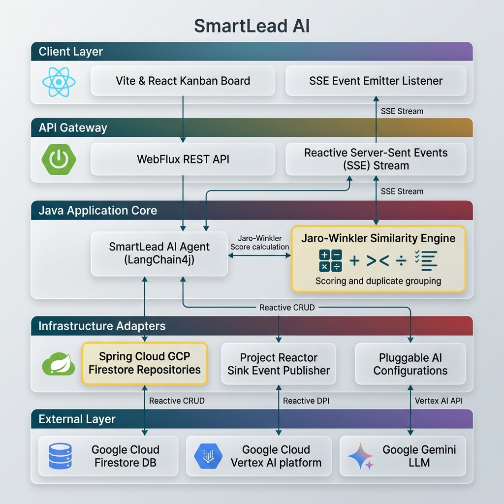
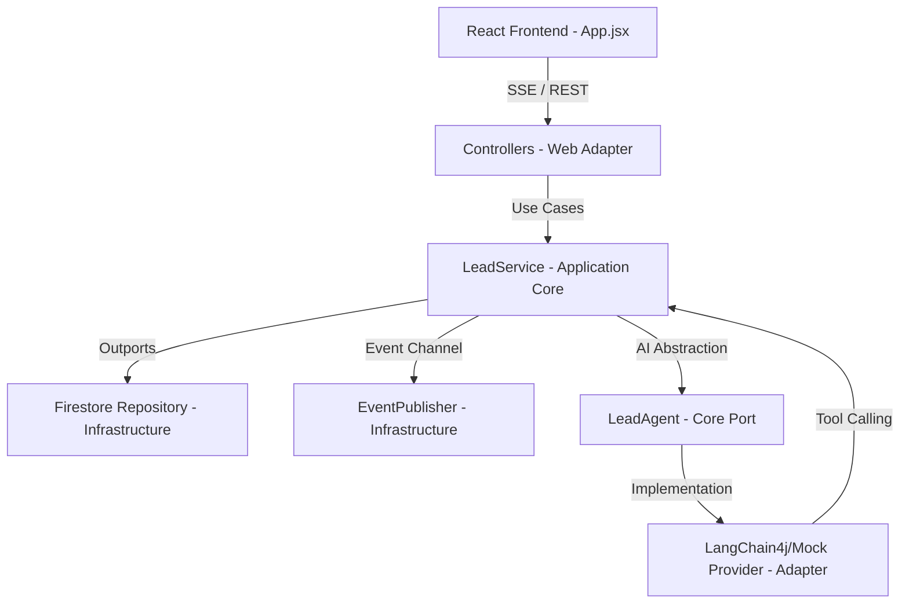

# SmartLead AI — B2B Sales Ops Data Steward Agent

SmartLead AI is a portfolio-ready B2B Sales Operations reference application. It demonstrates how to combine AI Agents (via **LangChain4j**) and custom Java data-quality matching algorithms to enrich and deduplicate messy CRM sales leads in real-time.

---

## ⚡ Pluggable AI Providers

The application supports three AI provider modes configured via the `ai.provider` property in [application.properties](file:///src/main/resources/application.properties):

1. **Mock Mode (`ai.provider=mock`) — [Default]**
   - Runs out-of-the-box locally with **zero configuration**.
   - Requires **no Google Cloud credentials**, billing, or Gemini API keys.
   - Intercepts steward chat commands (e.g., `"enrich leads"`, `"find duplicates"`, `"merge duplicates"`) and returns deterministic, high-fidelity mock LLM responses.
   - **Exercises the same Reactive service flow**: fetches from database/emulators, updates states, saves enriched data, and publishes SSE (Server-Sent Events) messages to update the React frontend Kanban board in real-time.

2. **Google AI Developer API Mode (`ai.provider=google-ai`)**
   - Calls the Google AI Studio Generative Language API directly.
   - Requires setting the `GEMINI_API_KEY` environment variable.
   - Ideal for cheap, simple external AI execution.

3. **Vertex AI Mode (`ai.provider=vertex-ai`)**
   - Calls Google Cloud Vertex AI's enterprise model catalog.
   - Relies on GCP Application Default Credentials (ADC) and project settings.

---

## 🏗️ Architecture & Boundaries

The project adheres to **Clean Architecture / Ports & Adapters (Hexagonal)** boundaries to maintain a clear separation of concerns, testability, and infrastructure pluggability.





- **Domain Layer (`domain`)**: Holds core entities (`Lead`, `GoldenLead`) and domain logic (`JaroWinklerMatcher` similarity algorithm). It is completely free of external frameworks or library dependencies.
- **Application Layer (`application`)**: Contains the core business orchestrator (`LeadService`), the agent declaration (`LeadAgent`), and the LangChain4j tool adapters (`LeadTools`).
  - **No Infrastructure Leaks**: `LeadTools` does not directly import database repositories or event publishers. Instead, it routes tool actions directly through `LeadService`, keeping the application boundaries clean.
- **Infrastructure Layer (`infrastructure`)**: Implements adapter ports for Firestore database queries (`LeadRepository`) and configurations for the different AI models (`AiConfig`, `MockLeadAgent`, `EventPublisher`).

---

## 🚀 Quick Start (Mock Mode)

### 1. Build and Run the Backend
Since it defaults to `mock` mode, you do not need GCP configuration or billing setup:

```bash
# Verify all tests compile and pass
./mvnw clean test    # Or on Windows PowerShell: .\mvnw.cmd clean test

# Run the Spring Boot application
./mvnw spring-boot:run
```
The server will start on port `8080`.

### 2. Run the Frontend
1. Navigate to the `frontend` directory:
   ```bash
   cd frontend
   ```
2. Install dependencies:
   ```bash
   npm install
   ```
3. Run the development server:
   ```bash
   npm run dev
   ```
4. Open [http://localhost:3000](http://localhost:3000) in your browser.

---

## 🛠️ Configuration Guide for Real AI Modes

To switch from the default `mock` mode to a live Gemini API model, configure the properties in [application.properties](file:///src/main/resources/application.properties):

### For Google AI Developer API (`ai.provider=google-ai`)
1. Obtain an API key from [Google AI Studio](https://aistudio.google.com/).
2. Export the environment variable:
   ```powershell
   # PowerShell
   $env:GEMINI_API_KEY="AIzaSy..."
   ```
3. Update configuration:
   ```properties
   ai.provider=google-ai
   gemini.api.key=${GEMINI_API_KEY}
   gemini.model.name=gemini-1.5-flash
   ```

### For Vertex AI (`ai.provider=vertex-ai`)
1. Log in using the gcloud CLI to authenticate Application Default Credentials (ADC):
   ```bash
   gcloud auth application-default login
   gcloud config set project YOUR_GCP_PROJECT_ID
   ```
2. Update configuration:
   ```properties
   ai.provider=vertex-ai
   spring.cloud.gcp.project-id=YOUR_GCP_PROJECT_ID
   gemini.location=us-central1
   gemini.model.name=gemini-1.5-flash
   ```
