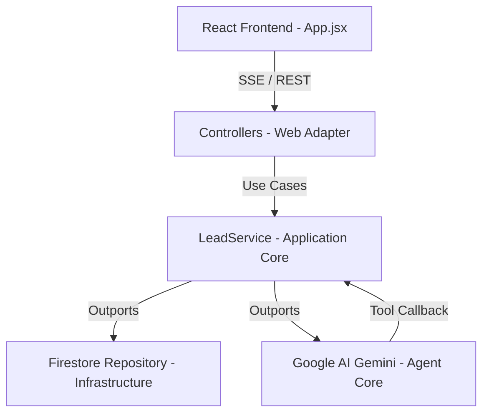

# SmartLead AI — Engineering Implementation Summary

This document provides a technical walkthrough of the architectural decisions, implementation steps, and deployment processes used to build **SmartLead AI**, a B2B Sales Ops Data Steward Agent.

---

## 1. System Architecture Overview
The application follows **Clean Architecture / Ports & Adapters (Hexagonal)** principles to ensure separation of concerns, testability, and flexibility.



- **Domain Layer:** Contains core business entities (`Lead` entity, `LeadStatus` enum) and domain services (`JaroWinklerMatcher` for duplicate candidate scoring). Free of external library dependencies.
- **Application Layer:** Defines the input ports (`LeadService`) and output port interfaces (repositories, chat model definitions). Holds the LLM agent definition (`LeadAgent` interface) and custom tools (`LeadTools`).
- **Infrastructure Layer:** Implements adapters for Firestore (`FirestoreLeadRepository` via Spring Cloud GCP) and configures the LLM integration (`AiConfig`).
- **Presentation Layer:** REST Controllers providing endpoints for seeding data, chat message dispatching, and SSE (Server-Sent Events) streaming.
- **Frontend:** A responsive Single-Page React App utilizing Tailwind CSS, displaying a Kanban board, lead tables, and a real-time AI Chat sidebar.

---

---

## 2. Step-by-Step Implementation Flow

### Step 1: Environment & Project Setup
We set up a Spring Boot project configured with Spring Cloud GCP dependencies.
- **Key dependencies added (`pom.xml`):**
  - `spring-boot-starter-web` & `spring-boot-starter-validation`
  - `spring-cloud-gcp-starter-data-firestore` for native Firestore integration.
  - `langchain4j-spring-boot-starter` & `langchain4j-google-ai-gemini` (upgraded to `0.35.0` to support modern Gemini models).

### Step 2: Domain Modeling & Persistence
1. Created the core `Lead` entity:
   - Fields: `id` (UUID), `name`, `company`, `email`, `status` (RAW, ENRICHED, DUPLICATE, MERGED), `enrichedIndustry`, `enrichedSize`, `enrichedTechStack`, `outreachMessage`, `mergedInto` (UUID reference), and `createdAt`.
2. Built the repository adapter using Spring Cloud GCP Data Firestore's `FirestoreReactiveRepository` or direct document mapper to interact with GCP Firestore in Datastore mode.

### Step 3: LLM Agent & Tool Calling Integration
We leveraged **LangChain4j's AI Services** to create an autonomous agent:
1. **Agent Definition (`LeadAgent`):**
   - Defined as an interface annotated with `@SystemMessage`. This prompt instructs the model on its persona (B2B Data Steward), goals, and bounds.
2. **Custom Java Tools (`LeadTools`):**
   - Configured methods annotated with `@Tool` so the Gemini model can call them dynamically.
   - Tools include:
     - `readAllRawLeads()`: Reads un-enriched records from Firestore.
     - `enrichLeadRecord(...)`: Saves LLM-researched firmographic data and personalized email drafts.
     - `findDuplicateCandidates()`: Calculates similarity scores between leads.
     - `mergeLeads(...)`: Flags duplicates and merges them into golden records.

### Step 4: Deduplication Algorithm (Jaro-Winkler)
Because raw lead data is often messy (e.g., "John S. at Google" vs "J. Smith at Alphabet Inc."), we implemented custom string-matching logic:
- Designed a `JaroWinklerMatcher` utility to evaluate name similarity.
- Evaluated email domains and company name permutations.
- Grouped candidates exceeding a threshold (e.g., `0.85`) and exposed these pairs to the LLM agent tool configuration so it could make smart merging decisions.

### Step 5: SSE (Server-Sent Events) Progress Streaming
To avoid timed-out REST requests during long enrichment tasks, we implemented a real-time progress architecture:
1. The frontend connects to `/api/leads/progress` using an `EventSource`.
2. When the AI Agent runs steps or calls tools, progress updates are published to a Spring `SseEmitter` or `Sink.Many` stream.
3. The frontend updates status badges dynamically in real-time.

---

---

## 3. Engineering Decisions & Troubleshooting Lessons

### 1. Transitive Dependency Conflicts
- **Problem:** Spring Cloud GCP and LangChain4j both transitively load different versions of the Vertex AI libraries, leading to classpath conflicts (`NoClassDefFoundError` for `ToolConfig`).
- **Resolution:** Upgraded the LangChain4j BOM to `0.35.0` and isolated model adapters.

### 2. Vertex AI (Enterprise) vs. Google AI (Developer) APIs
- **Observation:** In Google Cloud, `aiplatform.googleapis.com` is rebranded as the **Gemini Enterprise Agent Platform**. 
- **Gotcha:** Standard consumer model versions (like `gemini-1.5-flash-001` or `gemini-2.0-flash`) can return `NOT_FOUND` on Vertex AI endpoints if the specific project has restricted model provisioning or policy controls.
- **Pivot:** Switched the integration adapter to `langchain4j-google-ai-gemini` using the Generative Language API (`generativelanguage.googleapis.com`) with a dedicated API key for simpler development verification.

### 3. Rate-Limits & Billing Restrictions
- **Challenge:** Hit a `RESOURCE_EXHAUSTED` (429) error with code `limit: 0`, indicating that free-tier API credits for the developer key were exhausted.
- **Next steps to resolve:** Link a billing account to the Gemini API key in Google AI Studio or accept the enterprise Vertex AI Terms of Service in the GCP Console to enable the standard GCP pay-as-you-go billing pipeline.

---

---

## 4. How to Deploy & Verify

### Build & Deploy Commands
```bash
# 1. Compile and upload the container image via Google Cloud Build
gcloud builds submit --tag us-central1-docker.pkg.dev/YOUR_GCP_PROJECT_ID/cloud-run-source-deploy/gcp-java-smartlead-agent:latest --region us-central1 --project YOUR_GCP_PROJECT_ID

# 2. Deploy container to Cloud Run with the Gemini API Key injection
gcloud run deploy gcp-java-smartlead-agent \
  --image us-central1-docker.pkg.dev/YOUR_GCP_PROJECT_ID/cloud-run-source-deploy/gcp-java-smartlead-agent:latest \
  --region us-central1 \
  --project YOUR_GCP_PROJECT_ID \
  --allow-unauthenticated \
  --set-env-vars "GEMINI_API_KEY=YOUR_API_KEY_HERE"
```

### Verification API Flows
Use PowerShell or cURL to verify the application endpoints:
```powershell
# Seed messy data
Invoke-RestMethod -Uri "https://YOUR_CLOUD_RUN_URL/api/leads/seed" -Method POST

# Get current raw leads list
Invoke-RestMethod -Uri "https://YOUR_CLOUD_RUN_URL/api/leads" -Method GET
```
