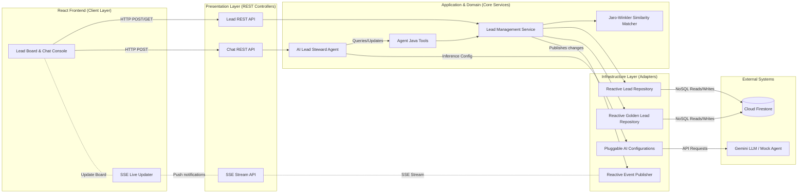

# Reference Architecture & Plan: SmartLead AI

This project is a B2B Sales Operations reference architecture demonstrating how to use AI Agents (via LangChain4j and Google AI Gemini) and custom Java data-quality matching to clean, enrich, and deduplicate sales leads in real-time.



---

## Technical Features & Stack

### 1. The Stack
* **Backend:** Java 17 + Spring Boot 3.3.0 (WebFlux / Reactive Architecture)
* **AI Orchestration:** LangChain4j + Google AI Gemini SDK & Vertex AI Gemini SDK (Upgraded to **0.35.0**)
* **Database:** Google Cloud Firestore (Native Mode, accessed via Spring Cloud GCP Starter Data Firestore)
* **Real-time Sync:** Server-Sent Events (SSE) using Project Reactor Sinks
* **Authentication:** Multi-provider support (API Key for Google AI Studio or GCP IAM / Application Default Credentials for Vertex AI)
* **Frontend:** React + Vite + Tailwind CSS (served statically by Spring Boot)

### 2. Core Agentic Logic (How the AI is Involved)
* **The "Lead Profiler & Researcher" Agent:**
  * Uses Gemini's training knowledge to automatically research the company (identifying its primary industry, estimated employee count, tech stack, and a short business description).
  * Generates a personalized outreach message based on the company's profile.
* **The Java Match Engine:**
  * Uses the Jaro-Winkler similarity algorithm implemented in Java to compute similarity scores between lead names and company names.
  * Exposed to the AI agent as a `@Tool` (`findDuplicateCandidates(double threshold)`).
* **The "Lead Steward" Agent:**
  * The user can chat with the agent in the sidebar (e.g. *"Show me duplicate leads"* or *"Merge the duplicate records for John Smith"*).
  * The agent calls Java tools to merge records, updates Firestore, and triggers an SSE broadcast to update the UI.

---

## The Sample Demo Dataset (LinkedIn Ready)

We seed Firestore with a realistic, messy dataset that highlights the deduplication and enrichment capabilities:

| Raw Name | Raw Company | Raw Email | Issue |
| :--- | :--- | :--- | :--- |
| **John S.** | **Google** | `john.smith@google.com` | Missing info, name is abbreviated |
| **J. Smith** | **Alphabet Inc.** | `jsmith@alphabet.com` | Duplicate of John S. (mismatched name/company variation) |
| **Marc B.** | **Salesforce** | `marcb@salesforce.com` | Incomplete info |
| **M. Benioff** | **Salesforce Inc.** | `benioff@salesforce.com` | Duplicate of Marc B. |
| **Alice J.** | **Netflix** | `alice@netflix.com` | Incomplete info |

---

## Actual Project Structure
The project is implemented in `C:\Users\cyarc\.gemini\antigravity-ide\scratch\gcp-java-smartlead-agent` using the following Clean Architecture structure:
```text
com.example.smartlead
├── SmartLeadApplication.java  # Spring Boot Application Entry Point
├── domain
│   ├── model                  # Lead.java, GoldenLead.java (representing domain documents)
│   └── service                # JaroWinklerMatcher.java (Java similarity matching algorithm)
├── application
│   └── service                # LeadAgent.java, LeadTools.java, LeadService.java (Core business logic & agent services)
├── infrastructure
│   ├── adapter                # LeadRepository.java, GoldenLeadRepository.java (Reactive Firestore Repositories)
│   └── config                 # AiConfig.java (Pluggable Google AI / Vertex AI / Mock configurations), EventPublisher.java, MockLeadAgent.java
└── presentation
    └── controller             # LeadController.java, EventController.java (SSE), ChatController.java (REST Controller for UI integration)
```

---

## Step-by-Step Implementation Roadmap

### Phase 1: Project Scaffolding
1. Create directory `C:\Users\cyarc\.gemini\antigravity-ide\scratch\gcp-java-smartlead-agent`.
2. Generate the Maven `pom.xml` with Spring Boot, Spring Cloud GCP, Project Reactor, and LangChain4j dependencies.
3. Add the Frontend build configuration and single-page React client under `frontend/`.

### Phase 2: GCP Resource Activation
Set up the default Firestore Native database and Vertex AI/Google AI APIs:
```powershell
gcloud config set project YOUR_GCP_PROJECT_ID
gcloud services enable firestore.googleapis.com generativelanguage.googleapis.com apikeys.googleapis.com
gcloud firestore databases create --location=nam5 --type=firestore-native
```

### Phase 3: Java Domain & Database Implementation
1. Write domain models and the Java Jaro-Winkler string matcher.
2. Implement the Firestore repository adapters extending `FirestoreReactiveRepository`.
3. Seed the initial messy dataset into Firestore.

### Phase 4: LangChain4j Agent & SSE Implementation
1. Configure pluggable `LeadAgent` (supporting `GoogleAiGeminiChatModel`, `VertexAiGeminiChatModel`, or local `MockLeadAgent` fallback).
2. Annotate agent tools in `LeadTools` using LangChain4j `@Tool` annotation.
3. Write the Event Publisher and SSE Controller to stream updates to the client in real-time.

### Phase 5: Glassmorphic React UI
1. Initialize the React app inside the project workspace.
2. Build the Kanban/Lead Board showing raw, enriched, and merged leads.
3. Build the chat panel and connect the SSE listener.

### Phase 6: Verification & Deployment
1. Test locally and verify the agent's function-calling capability.
2. Deploy to Cloud Run.

---

## Technical Alterations & Features Implemented

1. **Pluggable AI Providers:** Built pluggable configurations for three providers: `google-ai` (using Google AI Developer API with API Key), `vertex-ai` (using GCP IAM & ADC), and `mock` (an out-of-the-box offline Mock agent that mimics Gemini behavior using Java logic, allowing rapid frontend development without GCP configurations).
2. **SDK and Endpoint Shift:** Shifted to support the Google AI Developer API (`generativelanguage.googleapis.com`) using `gemini-1.5-flash` in addition to Vertex AI (`gemini-3.5-flash`) due to standard sandbox quota limitations.
3. **LangChain4j Upgrade:** Upgraded LangChain4j version to `0.35.0` in `pom.xml`.
4. **Reactive Stack Integration:** The entire backend is built reactive, utilizing Project Reactor `Flux`, `Mono`, and reactive Firestore drivers for low-latency streaming and high scalability.
