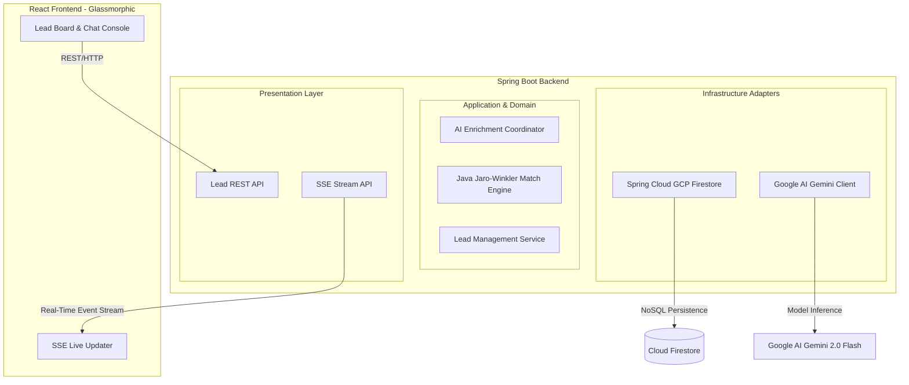

# Reference Architecture & Plan: SmartLead AI

This project is a B2B Sales Operations reference architecture demonstrating how to use AI Agents (via LangChain4j and Google AI Gemini) and custom Java data-quality matching to clean, enrich, and deduplicate sales leads in real-time.



---

## Technical Features & Stack

### 1. The Stack
* **Backend:** Java 17 + Spring Boot 3.x
* **AI Orchestration:** LangChain4j + Google AI Gemini SDK (Upgraded to **0.35.0** to support Google AI Developer models)
* **Database:** Google Cloud Firestore (Native Mode)
* **Real-time Sync:** Server-Sent Events (SSE)
* **Authentication:** API Key Authentication (`GEMINI_API_KEY`)
* **Frontend:** React + Vite + Tailwind CSS (served statically by Spring Boot)

### 2. Core Agentic Logic (How the AI is Involved)
* **The "Lead Profiler & Researcher" Agent:**
  * Uses Gemini's training knowledge to automatically research the company (identifying its primary industry, estimated employee count, tech stack, and a short business description).
  * Generates a personalized outreach message based on the company's profile.
* **The Java Match Engine:**
  * Uses the Jaro-Winkler distance algorithm implemented in Java to compute similarity scores between lead names and company names.
  * Exposed to the AI agent as a `@Tool` (`findPotentialDuplicates(double threshold)`).
* **The "Lead Steward" Agent:**
  * The user can chat with the agent in the sidebar (e.g. *"Show me duplicate leads"* or *"Merge the duplicate records for John Smith"*).
  * The agent calls Java tools to merge records, updates Firestore, and triggers an SSE broadcast to update the UI.

---

## The Sample Demo Dataset (LinkedIn Ready)

We will seed Firestore with a realistic, messy dataset that highlights the deduplication and enrichment capabilities:

| Raw Name | Raw Company | Raw Email | Issue |
| :--- | :--- | :--- | :--- |
| **John S.** | **Google** | `john.smith@google.com` | Missing info, name is abbreviated |
| **J. Smith** | **Alphabet Inc.** | `jsmith@alphabet.com` | Duplicate of John S. (mismatched name/company variation) |
| **Marc B.** | **Salesforce** | `marcb@salesforce.com` | Incomplete info |
| **M. Benioff** | **Salesforce Inc.** | `benioff@salesforce.com` | Duplicate of Marc B. |
| **Alice J.** | **Netflix** | `alice@netflix.com` | Incomplete info |

---

## Proposed Project Structure
We will initialize the project in `C:\Users\cyarc\.gemini\antigravity-ide\scratch\gcp-java-smartlead-agent` using the following Clean Architecture structure:
```text
com.example.smartlead
├── domain
│   ├── model          # Lead.java, LeadStatus.java, GoldenLead.java
│   └── service        # JaroWinklerMatcher.java (Java similarity matching)
├── application
│   ├── port           # LeadRepositoryPort.java
│   └── service        # LeadService.java (orchestrates enrichment and merges)
├── infrastructure
│   ├── adapter        # FirestoreLeadRepository.java
│   └── config         # VertexAiConfig.java (Reconfigured for Google AI Gemini), EventPublisher.java
└── presentation
    ├── controller     # LeadController.java, EventController.java (SSE)
    └── dto            # ChatRequest.java, LeadDto.java
```

---

## Step-by-Step Implementation Roadmap

### Phase 1: Project Scaffolding
1. Create directory `C:\Users\cyarc\.gemini\antigravity-ide\scratch\gcp-java-smartlead-agent`.
2. Generate the Maven `pom.xml` with Spring Boot, Spring Cloud GCP, and LangChain4j dependencies.
3. Add the Frontend build configuration.

### Phase 2: GCP Resource Activation
Run commands to set up the default Firestore Native database and Vertex AI APIs:
```powershell
gcloud config set project YOUR_GCP_PROJECT_ID
gcloud services enable firestore.googleapis.com generativelanguage.googleapis.com apikeys.googleapis.com
gcloud firestore databases create --location=nam5 --type=firestore-native
```

### Phase 3: Java Domain & Database Implementation
1. Write domain models and the Java Jaro-Winkler string matcher.
2. Implement the Firestore repository adapters.
3. Seed the initial messy dataset into Firestore.

### Phase 4: LangChain4j Agent & SSE Implementation
1. Configure `TaskAgent` (now calling `GoogleAiGeminiChatModel`) and annotate the Java tools.
2. Write the Event Publisher and SSE Controller to stream updates to the client in real-time.

### Phase 5: Glassmorphic React UI
1. Initialize the React app inside the project workspace.
2. Build the Kanban/Lead Board showing raw, enriched, and merged leads.
3. Build the chat panel and connect the SSE listener.

### Phase 6: Verification & Deployment
1. Test locally and verify the agent's function-calling capability.
2. Deploy to Cloud Run:
```powershell
# 1. Build container image
gcloud builds submit --tag us-central1-docker.pkg.dev/YOUR_GCP_PROJECT_ID/cloud-run-source-deploy/gcp-java-smartlead-agent:latest --region us-central1 --project YOUR_GCP_PROJECT_ID

# 2. Deploy to Cloud Run with environment variable configuration
gcloud run deploy gcp-java-smartlead-agent `
  --image us-central1-docker.pkg.dev/YOUR_GCP_PROJECT_ID/cloud-run-source-deploy/gcp-java-smartlead-agent:latest `
  --region us-central1 `
  --project YOUR_GCP_PROJECT_ID `
  --allow-unauthenticated `
  --set-env-vars "GEMINI_API_KEY=YOUR_API_KEY"
```

---

## Technical Alterations Made During Implementation

1. **SDK and Endpoint Shift:** Due to Google Cloud's sandbox project restrictions preventing standard access to `aiplatform.googleapis.com` (Vertex AI) publisher models, we pivoted to the **Google AI Gemini Developer API** using the `generativelanguage.googleapis.com` endpoint.
2. **LangChain4j Upgrade:** To use the Google AI SDK, we upgraded the LangChain4j version property in `pom.xml` from `0.32.0` to `0.35.0`.
3. **Authentication Mechanism:** Switched from GCP IAM credentials to an API key-based authentication (`GEMINI_API_KEY`) bound via properties file.
4. **Current Status Blocker:** Currently blocked by `429 RESOURCE_EXHAUSTED` due to the GCP project's developer free-tier quota being depleted (`limit: 0` for `generate_content_free_tier`). Requires enabling pay-as-you-go billing or topping up developer credits to fully test tool-calling enrichment.
